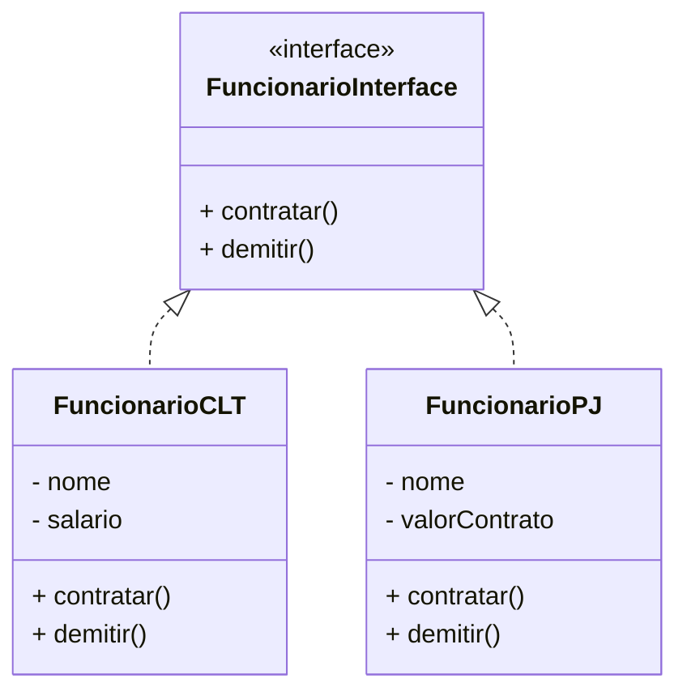

# S4_R1_AT1 - Atividade de interface:

# Interface

- Uma regra que todas as classes que implementam devem seguir.
- Define quais métodos as classes devem possuir.

# Diagrama Funcionário - Interface

**Interface →** Métodos obrigatórios (contratar e demitir).

**FuncionarioCLT e FuncionarioPJ →** Atributos e implementação dos métodos.

